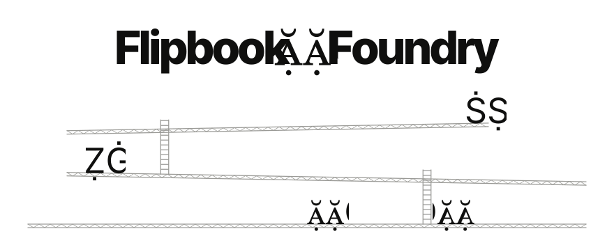

<picture>
  <source media="(prefers-color-scheme: dark)" srcset=".github/readme/banner-dark.svg">
  
</picture>

An animation library where every frame is a glyph.

Stick figures are drawn on a skeleton at build time and baked into fonts. At
runtime a figure is one character that gets swapped for the next drawing. Put
`{walk}` in a sentence and it walks, at text size, in the middle of your
paragraph. The API follows framer-motion (`animate`, `initial`, `exit`,
`variants`, `transition`, `whileHover`, `stagger`, sequences), with bindings for
Svelte, React and plain JavaScript.

**[Demo](https://flipbook-foundry.pages.dev)** · **[Docs](https://flipbook-foundry.pages.dev/docs)** · **[How it works](https://flipbook-foundry.pages.dev/how)**

```sh
npm i flipbook-foundry
```

## Quick start

**Svelte**

```svelte
<script>
  import { Page, Figure } from 'flipbook-foundry/svelte';
</script>

<!-- A JS string: in Svelte, {walk} inside quotes would be an expression. -->
<Page text={'Bob {walk} left the house. Sue {wave} waved.'} font="22px Georgia" />
<p>Hello <Figure animate="wave" whileHover="cheer" /></p>
```

**React**

```jsx
import { Page, Figure } from 'flipbook-foundry/react';

export default function App() {
  return (
    <>
      <Page text="Bob {walk} left the house. Sue {wave} waved." font="22px Georgia" />
      <p>Hello <Figure animate="wave" whileHover="cheer" /></p>
    </>
  );
}
```

**Plain JavaScript**

```js
import { createStage, animate } from 'flipbook-foundry';

const stage = createStage(document.querySelector('canvas'));
const bob = stage.add({ x: 0, y: 300, size: 80 });
animate(bob, { action: 'walk', x: 400 }).then(() => animate(bob, 'wave'));
```

Starters you can open in StackBlitz are in [`examples/`](examples/).

## Families

The engine draws figures from a *family*: a set of fonts plus a manifest of
actions. Families are separate packages, and `flipbook-foundry` comes with the
first one, [`@flipbook-foundry/stick`](packages/stick), as its default.

```js
import stick from '@flipbook-foundry/stick';
import { setDefaultFamily } from 'flipbook-foundry';

setDefaultFamily(stick);                    // everything, everywhere
<FlipbookConfig family={stick}> … </FlipbookConfig>   // a subtree
<Stage family={stick}> … </Stage>           // one Stage (its Figures follow it)
<Page family={stick} text={…} />            // one paragraph
```

Each family's fonts load from jsDelivr, pinned to the version you installed,
and only the chunks your figures use (2–24 KB each, about 185 KB for a whole
weight). To self-host, copy `node_modules/@flipbook-foundry/stick/fonts/` into
your public folder and call `setFontBase('/fonts/', stick)` once at startup.

The `.otf` files install like any other font, so the figures work in Figma,
Keynote or a word processor too.

## What's in it

- **Actions.** Walks, runs, jumps, trips, sits, waves, high-fives, digs and
  more. Every one is listed on the [demo page](https://flipbook-foundry.pages.dev).
- **Text that makes room.** `<Page>` and `<TextFlow>` lay out text with
  [pretext](https://github.com/chenglou/pretext), re-wrapping around moving
  figures every frame.
- **Grounded motion.** Each frame ships with how far the planted foot
  travelled, so figures cover ground without sliding.
- **A shared rest state.** Every action starts and ends on a rest pose, and
  every loop has exit frames with baked settles into it. Changing action
  waits for the next exit, settles, routes to the right rest pose, and goes:
  `animate="sit-idle"` from a run plays the stop and the sit-down first, and
  nothing cuts mid-pose unless you ask for `{ interrupt: 'cut' }`.
- **Letters with legs.** Any letter in any font can be the body, with limbs from
  the Flipbook Stick Limbs font.
- **Props.** Shovels, brooms and sacks in the Flipbook Stick Things font, held
  at the hands.

## Accessibility

Inline figures are `aria-hidden`. `<Page>` and `<TextFlow>` draw on a canvas and
put the same words, without the `{action}` tokens, in visually hidden text for
screen readers. `<Figure>` freezes on its first frame under
`prefers-reduced-motion` (override with `<FlipbookConfig reducedMotion>`);
`<Page>` and `<Stage>` don't yet.

Figures are private-use codepoints. Copied out of the page, they paste as empty
boxes anywhere the family's font isn't installed.

## Developing

```sh
npm install
npm run dev        # bake the fonts, start the site at localhost:5173
```

| | |
|---|---|
| `npm run build:font [family]` | bake a family's fonts and manifest (default: stick) |
| `npm test` | runtime checks (routing, travel, ledges, events) |
| `npm run check` | type check |
| `npm run package` | build the engine into `packages/engine/dist/` |
| `npm run sheet walk run` | contact sheets in `.sheets/` (strip, world track, onion skin) |
| `npx tsx scripts/overview.ts` | every action on one page |
| `npx tsx scripts/skate.ts walk` | planted-foot drift per frame |
| `npm run banner` | re-bake the animated README banner in `.github/readme/` |

```
packages/
  engine/       flipbook-foundry: the runtime, no fonts
    src/core/     frameloop, library, Character, Stage, animate, stagger,
                  page + textflow (pretext), behaviors
    src/svelte/   <Stage> <Figure> <TextFlow> <Page> <Thing> <FlipbookConfig> use:figure
    src/react/    the same for React, plus useAnimate and useStage
  stick/        @flipbook-foundry/stick: fonts/, generated/ manifest, family.ts bake config
  rig/          private, build time only: humanoid skeleton, skins, spline
                timeline, ground solver, and the shared action library
scripts/        the baker, contact sheets, packing, tests
src/            the demo site (imports the packages from source)
```

Site routes: `/` demo, `/docs` API reference, `/how` how it works, `/forge`
character and action builder. `/lab` and `/ds` are internal review tools and
only exist in `npm run dev`.

New actions go in `packages/rig/actions/`; new families get their own
`packages/<id>/`. See [CONTRIBUTING.md](CONTRIBUTING.md).

## License

Code: [MIT](LICENSE). Fonts: [SIL Open Font License 1.1](packages/stick/OFL.txt).
